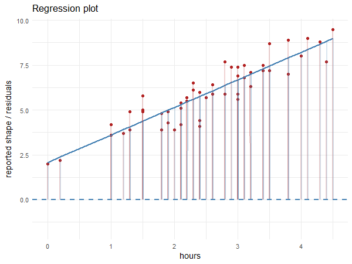

--- 
title: "12: Residuals and polynomial fitting"
---

## {data-name="Review" background-iframe="https://wall.sli.do/event/9HN7eFh37sHBd29xn64cLL?section=290ab010-501b-4d19-a56a-01d07abf3249&integration=shared-present-mode&utm_source=slidoadmin" background-interactive=true}


<!--

## Answer {.conditional data-admin="true" data-date="2026-04-18"}

```r
model1 <- lm(reported_shape ~ hours, data = data)
model1
```
```{r}

library(tidyverse)

data1 <- read_csv("./data/shapeVsHours.csv")

model1 <- lm(reported_shape ~ hours, data = data1)

model1
```

## Plotting the line

::: {.conditional data-admin="true" data-date="2026-04-18"}

```r
ggplot(data=..., aes(x=..., y=...)) + geom_point() + geom_smooth(method="lm")
```

```{r}

ggplot(data=data1, aes(x=hours, y=reported_shape)) + geom_point() + geom_smooth(method="lm")

```

:::
-->


## What are residuals? {data-name="Residuals"}

::::: panel-tabset

### The gist
::: card-list-center

- Residuals = Estimated "errors" from our fitted model.

- $\text{Data} =  \underbrace{\text{Slope} \times x + \text{Intercept}}_\text{Fitted Line} + \text{Residuals}$

- $\text{Residuals} = \text{Data} - \text{Fitted Line}$

:::

### Illustration

{fig-align="center" fig-alt="Residuals = Data - Fitted Line" height="300px"}

### Implication

What can residuals tell us about our fitted model?

- Since the true errors are random (by definition), if our fitted model is correct, the residuals should also be random.

<!--

### Slightly more accurate

$y_\text{model} = \text{intercept}_\text{model} + \text{slope}_\text{model} \times x_\text{data points}$

$y_\text{data points} =  y_\text{model} + \text{errors}_\text{model}$

$\text{errors}_\text{model} = y_\text{data points} - y_\text{model}$

-->

::::::


## Residual plots

::: {.nonincremental}

- `Residuals of Dependent Variable ~ Independent Variable`

```{r}
#| fig-align: "center"

data1 <- data1 %>% mutate(resids = model1$residuals)

ggplot(data=data1, aes(x=hours, y=resids)) + geom_point() + geom_smooth(method="lm", color = "firebrick")

```

- Because residuals are noise, they should look random. The model we fit is wrong if the residuals don't look random (linear trend with slope = 0).

:::

## Compare these plots

```{r}
plot1 <- ggplot(data=data1, aes(x=hours, y=reported_shape)) + geom_point() + geom_smooth(method="lm") + labs(title="Regression")

data1 <- data1 %>% mutate(resids = model1$residuals)

plot2 <- ggplot(data=data1, aes(x=hours, y=resids)) + geom_point() + geom_smooth(method="lm", color = "firebrick") + labs(title="Residuals")

data2 <- read_csv("./data/bpmVsHours.csv")

plot3 <- ggplot(data=data2, aes(x=hours, y=bpm)) + geom_point() + geom_smooth(method="lm") + labs(title="Regression")


model2 <- lm(bpm ~ hours, data=data2)

data2 <- data2 %>% mutate(resids = model2$residuals)

plot4 <- ggplot(data=data2, aes(x=hours, y=resids)) + geom_point() + geom_smooth(method="lm", color = "firebrick") + labs(title="Residuals")

model3 <- lm(data2$bpm ~ poly(data2$hours,2))

data2 <- data2 %>% mutate(poly_resids = model3$residuals)

plot5 <- ggplot(data=data2, aes(x=hours, y=resids)) + geom_point()

plot6 <- ggplot(data=data2, aes(x=hours, y=poly_resids)) + geom_point()


```

:::: columns
::: {.column .nonincremental data-id="dataset1"}

**Dataset 1: Reported shape vs. hours**

::: {data-id="plot1"}

```{r}
#| fig-width: 6
#| fig-height: 3
plot1
```

:::

::: {data-id="plot2"}

```{r}
#| fig-width: 6
#| fig-height: 3
plot2
```
:::

:::

::: {.column .nonincremental data-id="dataset2"}

**Dataset 2: Heart rate vs. hours**

::: {data-id="plot3"}

```{r}
#| fig-width: 6
#| fig-height: 3
plot3
```

:::

::: {data-id="plot4"}

```{r}
#| fig-width: 6
#| fig-height: 3
plot4
```

:::

:::
::::

## Interpretations {data-name="Interpretations"}


:::: columns
::: {.column .nonincremental data-id="dataset1" .blur}

**Dataset 1: Reported shape vs. hours**

::: {data-id="plot1"}

```{r}
#| fig-width: 6
#| fig-height: 3
plot1
```

:::

::: {data-id="plot2"}

```{r}
#| fig-width: 6
#| fig-height: 3
plot2
```

:::
:::


::: {.column .nonincremental data-id="dataset2" width="50%"}

**Dataset 2: Heart rate vs. hours**


- We can see that in the second dataset, there is still a pattern in the residual plot. Specifically, there is an clear curve in residuals. 


::: {data-id="plot4"}

```{r}
#| fig-width: 6
#| fig-height: 3
plot4
```

:::

:::
::::


## Interpretations

:::: columns
::: {.column .nonincremental data-id="dataset1" .blur}

**Dataset 1: Reported shape vs. hours**

::: {data-id="plot1"}

```{r}
#| fig-width: 6
#| fig-height: 3
plot1
```

:::

::: {data-id="plot2"}

```{r}
#| fig-width: 6
#| fig-height: 3
plot2
```

:::
:::

::: {.column .nonincremental data-id="dataset2"}

**Dataset 2: Heart rate vs. hours**


::: {data-id="plot3"}

```{r}
#| fig-width: 6
#| fig-height: 3
plot3
```
:::

- This means that the straight line model is not accounting for all systematic variance in the data. 

:::


::::


## Interpretations

::: columns

::: {.column .nonincremental}

::: nonincremental

```{r}
#| fig-width: 6
#| fig-height: 3
plot5
```

- A better (curvier) model should be chosen to account for more of the systematic patterns in the residuals.

:::

:::

::: column

::: nonincremental

- When we take the difference between a well fitted model and the data, the residuals will appear more randomly scattered.

```{r}
#| fig-width: 6
#| fig-height: 3
plot6
```
:::

:::

:::


## Polynomials vs. linear functions {data-name="Polynomials"}

::: nonincremental
- Polynomial functions allows us to fit curvy models to the data.
:::

:::::: columns
::::: {.column .nonincremental}

::: nonincremental
- Degree 1: $y \sim x$ (linear)
- Degree 2: $y \sim x^2$ (polynomial)
- Degree 3: $y \sim x^3$ (polynomial)
:::

:::::

::::: {.column .nonincremental}

```{r}
#| fig-width: 5
#| fig-height: 4

x = seq(0, 10, by = 0.01)

`y = x` <- x

`y = x^2` <- x^2

`y = x^3` <- x^3

poly <- tibble(x=x, `y = x`=`y = x`, `y = x^2` = `y = x^2`, `y = x^3` = `y = x^3`)

poly <- poly %>% pivot_longer(names_to = "Degree", values_to = "y", cols = c(2,3,4))

ggplot(data=poly, aes(x=x, y=y, color = Degree)) + geom_line() + ylim(0,100)

```

:::::

::::::


## Deliverables {data-name="Deliverables"}


:::::: panel-tabset

## Scatterplots

You are interested the relationship between shape (dependent variable) and hours (independent variable). Solve the code puzzles given the following data table:

```r
head(shape)
```
```{r}
library(tidyverse)
shape <- read_csv("data/shapeVsHours.csv")
head(shape)
```

We created scatterplots last week, but here's is a reminder.


For the scatter plot (without the fitted line)

::: code-puzzle
::: static

ggplot({{shape}}, aes(x={{{hours}}}, y={{{reported_shape}}})) + geom_{{point}}()

:::
:::

```{r}

ggplot(shape, aes(y=reported_shape, x=hours)) + geom_point()

```

For the fitted line layer (without the scatter)

::: code-puzzle
::: static

... + geom_{{smooth}}({{method}}="{{lm}}")

:::
:::


```{r}
ggplot(shape, aes(y=reported_shape, x=hours)) + geom_smooth(method="lm")
```


## Getting residuals with `lm()`

You are interested the relationship between shape (dependent variable) and hours (independent variable). Solve the code puzzles given the following data table:

```r
head(shape)
```
```{r}
head(shape)
```

The `lm()` function in R automatically calculates the residuals for you and stores it in its output. 

::: code-puzzle
::: static

lm_shape <- lm({{{reported_shape}}} ~ {{{hours}}}, data = {{{shape}}})

shape_resids <- {{{lm_shape}}}$residuals
:::
:::

```r
shape_resids
```
```{r}
lm_shape <- lm(reported_shape ~ hours, data = shape)
shape_resids <- lm_shape$residuals
shape_resids
```


## `poly()` function

You are interested the relationship between shape (dependent variable) and hours (independent variable). Solve the code puzzles given the following data table:

```r
head(shape)
```
```{r}
head(shape)
```

::: nonincremental

This is how you fit a polynomial function of degree 1 using `lm()` (equivalent to last week's method)
        
::: code-puzzle
::: static
lm({{shape}}\${{reported_shape}} ~ poly(shape\${{hours}}, 1))
:::
:::

Based on the previous example, how would you fit a polynomial function of degree 2?

::: code-puzzle
::: static
lm({{{shape}}}\${{{reported_shape}}} ~ poly({{{shape}}}\${{{hours}}}, {{{2}}}))
:::
:::

:::

## Adding residuals to your dataset

You are interested the relationship between shape (dependent variable) and hours (independent variable). Solve the code puzzles given the following data table:

```r
head(shape)
```
```{r}
head(shape)
```

Add a column called "residuals" to the existing data table and fill that column with the residuals you got from `lm()`.

::: code-puzzle
::: static

{{{shape}}} <- {{shape}} %>% {{{mutate}}}({{{residuals}}} =  {{shape_resids}})

:::
:::

```r
head(shape)
```
```{r}
shape <- shape %>% mutate(residuals =  shape_resids)
head(shape)
```

<!--
## Plotting a curved line

```r
ggplot(data=data2, aes(x=..., y=...)) + geom_point() + 
    geom_smooth(method="lm", formula = y ~ poly(x, 2))
```

```{r}
#| fig-height: 4

ggplot(data=data2, aes(x=hours, y=bpm)) + geom_point() + geom_smooth(method="lm", formula = y ~ poly(x, 2))

```
-->
::::::
